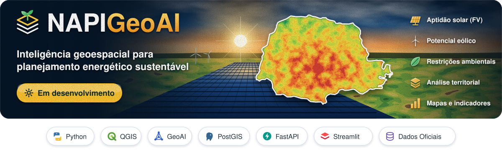

# NAPI GeoAI

<div align="center">




[](ROADMAP.md)
[](docs/ARQUITETURA.md)
[](docs/STREAMLIT_UI.md)
[](docs/ARQUITETURA.md)

</div>

**Plataforma de inteligência territorial e energética do Paraná.**

**Idioma:** [Português](README.md) | [English](README.en.md)

> **Status em 19/11/2026:** portal Streamlit funcional em execução local, com dados oficiais dos 399 municípios do Paraná em cinco frentes: território, população, energia, agropecuária e cobertura da terra. Ainda não há publicação no Streamlit Community Cloud. O portal não calcula aptidão fotovoltaica e não declara viabilidade econômica.

## Visão geral

O NAPI GeoAI é uma iniciativa de pesquisa e desenvolvimento liderada por **Anuar Mincache**, no contexto do **NAPI Energia Zero-Carbono (NAPI EZC)**, com a Universidade Estadual de Maringá (UEM) e a Fundação Araucária.

A plataforma reúne dados públicos que ficam espalhados em vários órgãos e os apresenta por município. O objetivo é ajudar pesquisadores, empreendedores, cooperativas e gestores públicos a conhecer o território e a escolher o que merece um estudo mais profundo.

O caminho que o portal propõe:

**Conhecer o território → explorar indicadores → comparar regiões → identificar sinais → investigar restrições → formular hipóteses → apoiar estudos de viabilidade.**

O portal ajuda a priorizar investigações. Ele não substitui projeto, licenciamento nem estudo de viabilidade.

## O que o portal oferece hoje

| Área | Página | O que mostra | Fonte e referência | Situação |
|---|---|---|---|---|
| Início | Home | Indicadores do estado, mapa, busca de município e caminhos por público | Artefatos do repositório | Disponível |
| Território | Ficha do município | Território, população, energia e agropecuária de um município em um só lugar | IBGE, ANEEL | Disponível |
| Território | Explorar o mapa | Os 399 municípios, busca por nome ou código IBGE, comparação de áreas | IBGE, malha municipal 2025 | Disponível |
| Energia | Solar e geração distribuída | Instalações MMGD e potência instalada por município, tecnologia e classe de consumo | ANEEL MMGD, retrato de 11/2026 | Disponível |
| Energia | Usinas e geração centralizada | Usinas em operação, potência fiscalizada e outorgada, composição por tecnologia | ANEEL SIGA, coleta de 11/11/2026 | Disponível |
| Energia | Calculadoras | Consumo e custo de equipamentos, dimensionamento fotovoltaico preliminar | Entradas do usuário | Disponível |
| Território | Agricultura e pecuária | Lavouras, rebanhos e leite por município, com mapa e CSV | IBGE PAM e PPM, 2025 | Disponível |
| Território | Cobertura da terra | Floresta, agricultura, pastagem e área urbana, de 1985 a 2025 | MapBiomas Coleção 11 | Disponível |
| Território | Vegetação por satélite | Lista de 97 municípios e plano do ciclo de NDVI | Copernicus Sentinel-2 | Parcial: nenhum mapa de NDVI publicado |
| Transparência | Fontes e qualidade | Catálogo de fontes, licenças e situação de cada uma | Catálogo do projeto | Disponível |
| Transparência | Sobre o projeto | O que é, quem faz e detalhes técnicos | Projeto | Disponível |

Ainda indisponível: unidades de conservação, recursos hídricos, recurso solar e aptidão territorial, biogás, observatório em tempo quase real, radar de oportunidades e assistente de IA. Veja o [ROADMAP.md](ROADMAP.md).

## Regras científicas

Nenhum indicador, mapa ou texto do portal usa número inventado ou preenchimento artificial.

- **A, dado oficial:** registrado diretamente na fonte.
- **B, indicador derivado:** cálculo determinístico sobre dados oficiais, com fórmula e unidade.
- **C, modelo ou simulação:** estimativa com hipóteses declaradas.

Zero verdadeiro, dado indisponível, sigilo estatístico e município sem registro aparecem de forma diferente. Falta de dado é mostrada como falta de dado. Cada artefato traz proveniência, data de coleta e SHA-256 do arquivo de origem.

## Como rodar

Requisitos: Python 3.12 ou superior.

```powershell
git clone https://github.com/anuarmincache/napi-geoai.git
cd napi-geoai
python -m pip install -e ".[ui]"
python -m streamlit run app/Home.py
```

O portal abre em `http://localhost:8501`. Ele lê apenas os artefatos de `data/derived/`, sem baixar nada e sem banco de dados.

Para desenvolvimento:

```powershell
python -m pip install -e ".[dev,ui]"
ruff check .
pytest -q
```

Guia completo para Windows: [docs/INSTALACAO_WINDOWS.md](docs/INSTALACAO_WINDOWS.md).

## Como os dados são gerados

Os dados brutos ficam fora do Git, em `data/raw/`. Cada script baixa da fonte oficial, valida e grava um artefato leve em `data/derived/`. Se uma etapa falha, nada é sobrescrito.

| Dado | Script | Artefato principal |
|---|---|---|
| Malha municipal IBGE 2025 | `scripts/prepare_parana_municipalities.py` | `parana_municipios_2025_presentation.geojson` |
| População IBGE 2026 | `scripts/prepare_population_parana.py` | `ibge_pr_population_2026_panel.json` |
| Usinas ANEEL SIGA | `scripts/prepare_siga_parana.py` | `siga_pr_energy_panel.json` |
| Geração distribuída ANEEL MMGD | `scripts/prepare_mmgd_parana.py` | `mmgd_pr_panel.json` |
| Lavouras e pecuária IBGE (PAM e PPM) | `scripts/prepare_agro_parana.py` | `agro_pr_panel.json` |
| Cobertura da terra MapBiomas | `scripts/inspect_mapbiomas_col11.py` e `scripts/prepare_mapbiomas_parana.py` | `mapbiomas_pr_landcover_panel.json` |
| Municípios-alvo do NDVI | `scripts/prepare_ndvi_targets.py` | `ndvi_targets_pr.json` |
| Plano do ciclo de NDVI | `scripts/plan_ndvi_targets.py` | `ndvi_plan_pr.json` |

## Arquitetura

```text
Fontes oficiais (IBGE, ANEEL, MapBiomas, Copernicus)
           ↓
Conectores e validação (geoai/connectors, geoai/quality)
           ↓
Processamento e agregação (geoai/energy, geoai/agriculture,
                           geoai/landcover, geoai/sentinel)
           ↓
Artefatos com proveniência (data/derived)
           ↓
Serviços de apresentação (geoai/portal)
           ↓
Interface Streamlit (app/)
```

A interface não contém regra de negócio: ela lê os serviços de `geoai/portal`. PostgreSQL/PostGIS e FastAPI estão preparados para uso futuro e não são necessários para rodar o portal. Detalhes em [docs/ARQUITETURA.md](docs/ARQUITETURA.md) e [docs/ARQUITETURA_MODULAR.md](docs/ARQUITETURA_MODULAR.md).

Identidade visual: paleta e logotipo do NAPI Energia Zero-Carbono, com ilustrações próprias em SVG. Ver [docs/STREAMLIT_UI.md](docs/STREAMLIT_UI.md).

## Histórico das entregas

| Etapa | Entrega | Documento |
|---|---|---|
| MVP 01 a 03 | Fundação Python, limites IBGE, catálogo de fontes e contratos de ingestão | [FONTES_OFICIAIS](docs/FONTES_OFICIAIS.md) |
| MVP 04 e 05 | PostGIS local, backup, restauração e auditoria | [OPERACAO_BANCO](docs/OPERACAO_BANCO.md) |
| MVP 06 a 08 | Arquitetura modular, interface Streamlit e preparo para a Community Cloud | [MVP08_DEPLOY](docs/MVP08_DEPLOY.md) |
| MVP 09 | Explorador dos 399 municípios | [MVP09_EXPLORADOR](docs/MVP09_EXPLORADOR.md) |
| MVP 10 | Painel de usinas ANEEL SIGA | [MVP10_ENERGIA](docs/MVP10_ENERGIA.md) |
| MVP 11 | População IBGE 2026 e ficha municipal | [MVP11_POPULACAO](docs/MVP11_POPULACAO.md) |
| MVP 12 | Meio Ambiente com MapBiomas Coleção 11 | [MAPBIOMAS_COLECAO11](docs/MAPBIOMAS_COLECAO11.md) |
| MVP 13 | Agricultura com IBGE PAM e PPM | [MVP13_AGRICULTURA](docs/MVP13_AGRICULTURA.md) |
| MVP 14 | Geração distribuída ANEEL MMGD | [MVP14_FASE2_RELATORIO](docs/MVP14_FASE2_RELATORIO.md) |
| Issue #38 | Calculadoras de consumo e fotovoltaico preliminar | [STREAMLIT_UI](docs/STREAMLIT_UI.md) |
| Issues #40 e #42 | Jobs geoespaciais e piloto Sentinel-2 em Maringá | [SENTINEL_PILOTO](docs/SENTINEL_PILOTO.md) |
| NDVI estadual | Lista de 97 municípios e plano otimizado do ciclo | [NDVI_CIDADES](docs/NDVI_CIDADES.md) |
| Portal | Home nova, ficha integrada e identidade NAPI EZC | [STREAMLIT_UI](docs/STREAMLIT_UI.md) |

## Limites conhecidos

- **Sem publicação pública.** O portal roda localmente. A publicação no Streamlit Community Cloud depende de aprovação.
- **NDVI sem imagens.** Só Maringá tem cena medida (73,1% de pixels válidos). Nenhum mapa de NDVI está publicado. O motor ainda está fixo em Maringá.
- **Cobertura da terra e área IBGE não coincidem exatamente.** Diferença mediana de 0,22% e máxima de 4,82%. Os hectares não são reescalados.
- **Mudança de cobertura não é desmatamento.** A página mostra diferença de estoque por classe entre dois anos.
- **Potência não é energia.** MW e GW são potência instalada, não geração em MWh.
- **MMGD e SIGA não se somam.** São cadastros diferentes.
- **Efetivo de rebanho não é resíduo disponível** para biodigestores.

## Equipe e reconhecimento

**Idealização e liderança técnica:** Anuar Mincache.

**Colaboradores científicos (participação confirmada pelo responsável do projeto):** Luiz Fernando Cotica; Ivair Aparecido Santos; Gustavo Sanguino Dias.

**Instituições:** NAPI Energia Zero-Carbono, Universidade Estadual de Maringá (UEM) e Fundação Araucária.

Veja [AUTHORS.md](AUTHORS.md). O projeto está hospedado nesta conta pessoal. Eventual vinculação ou transferência institucional dependerá de definição e autorização apropriadas.

## Licença

**Ainda não definida.** O repositório é público para consulta, mas não há licença de reutilização concedida neste momento. Os dados seguem as licenças das fontes: ANEEL (ODbL), IBGE (uso livre com citação) e MapBiomas (uso público com citação obrigatória).

## Exemplos do que o portal entrega

Os valores abaixo foram lidos dos artefatos de `data/derived/` em 19/11/2026. São retratos datados, não dados em tempo real.

### 1. Ficha do município: Maringá (4115200)

| Indicador | Valor | Fonte | Classe |
|---|---:|---|:---:|
| População estimada | 432.635 hab | IBGE, estimativa de 01/07/2026 | A |
| Área | 487,9 km² | IBGE, malha municipal 2025 | A |
| Densidade | 886,7 hab/km² | população ÷ área | B |
| Usinas em operação | 9 | ANEEL SIGA | A |
| Potência fiscalizada das usinas | 20,6 MW | ANEEL SIGA | A |
| Instalações de geração distribuída | 18.163 | ANEEL MMGD, 11/2026 | A |
| Potência de geração distribuída | 320,6 MW | ANEEL MMGD, 11/2026 | A |
| Geração distribuída por habitante | 0,74 kW/hab | potência MMGD ÷ população | B |
| Bovinos | 4.226 cabeças | IBGE PPM 2025 | A |
| Suínos | 2.121 cabeças | IBGE PPM 2025 | A |
| Leite | 2.960 mil litros | IBGE PPM 2025 | A |
| Soja, área plantada | 25.000 ha | IBGE PAM 2025 | A |
| Agricultura na cobertura da terra | 58,6% da área mapeada | MapBiomas Coleção 11, 2025 | B |
| Área urbanizada | 21,5% da área mapeada | MapBiomas Coleção 11, 2025 | B |

### 2. Geração distribuída: maiores potências instaladas

| Município | Potência instalada | Instalações |
|---|---:|---:|
| Foz do Iguaçu | 401,9 MW | 23.165 |
| Maringá | 320,6 MW | 18.163 |
| Curitiba | 305,6 MW | 14.711 |
| Londrina | 238,1 MW | 13.482 |
| Toledo | 199,7 MW | 9.574 |
| **Paraná** | **6.901,8 MW** | **335.899** |

Fonte: ANEEL MMGD, retrato de 11/2026. Ordenação descritiva. Muitas instalações não provam saturação de mercado, demanda futura nem rentabilidade.

### 3. Geração distribuída por classe de consumo no Paraná

| Classe | Instalações |
|---|---:|
| Residencial | 234.600 |
| Rural | 50.994 |
| Comercial | 35.795 |
| Industrial | 8.685 |
| Outras classes | 5.825 |

Fonte: ANEEL MMGD, retrato de 11/2026.

### 4. Lavouras no Paraná

| Cultura | Área plantada | Quantidade produzida |
|---|---:|---:|
| Soja (em grão) | 5.842.842 ha | 21.292.721 t |
| Milho (em grão) | 3.117.175 ha | 20.415.302 t |
| Trigo (em grão) | 853.993 ha | 2.758.533 t |
| Feijão (em grão) | 519.617 ha | 865.664 t |
| Cana-de-açúcar | 505.594 ha | 36.204.786 t |
| Mandioca | 142.304 ha | 3.960.047 t |

Fonte: IBGE, Produção Agrícola Municipal 2025, tabela SIDRA 5457. Soma dos valores municipais publicados. Área plantada não é cobertura do solo.

### 5. Pecuária no Paraná

| Indicador | Valor |
|---|---:|
| Bovinos | 8.472.972 cabeças |
| Suínos | 7.047.439 cabeças |
| Galináceos | 463.493.696 cabeças |
| Leite | 4.800.865 mil litros |

Fonte: IBGE, Pesquisa da Pecuária Municipal 2025, tabelas SIDRA 3939 e 74.

### 6. Cobertura e uso da terra no Paraná

| Classe | 1985 | 2025 | Diferença | Parcela em 2025 |
|---|---:|---:|---:|---:|
| Agricultura | 4.340.089 ha | 6.882.775 ha | +2.542.686 ha | 34,5% |
| Floresta | 5.365.896 ha | 5.321.493 ha | −44.402 ha | 26,7% |
| Pastagem | 6.530.812 ha | 3.446.597 ha | −3.084.215 ha | 17,3% |
| Mosaico de usos | 2.333.808 ha | 2.011.050 ha | −322.758 ha | 10,1% |
| Silvicultura | 450.901 ha | 1.224.315 ha | +773.414 ha | 6,1% |
| Corpo d'água | 370.629 ha | 401.904 ha | +31.275 ha | 2,0% |
| Área urbanizada | 149.915 ha | 319.949 ha | +170.034 ha | 1,6% |
| Vegetação herbácea e arbustiva | 373.704 ha | 291.917 ha | −81.788 ha | 1,5% |
| Outras áreas não vegetadas | 11.231 ha | 26.985 ha | +15.754 ha | 0,1% |

Fonte: Projeto MapBiomas, Coleção 11 da Série Anual de Mapas de Cobertura e Uso da Terra do Brasil. Diferença de estoque entre os dois anos. Não é taxa de desmatamento.

### 7. Calculadoras

Exemplo de preenchimento. Todos os valores de entrada são do usuário.

| Calculadora | Entradas do exemplo | Resultado |
|---|---|---|
| Consumo de um motor | 1.500 W, 4 h por dia, 22 dias por mês | 132 kWh por mês |
| Consumo de iluminação | 10 lâmpadas de 40 W, 8 h por dia, 30 dias | 96 kWh por mês |
| Fotovoltaico preliminar | 450 kWh por mês, irradiação de 4,5 kWh/m²/dia, desempenho 0,75, módulos de 550 Wp | 4,44 kWp, 9 módulos, cerca de 501 kWh por mês |

Fórmulas: `E = P × h × d × n ÷ 1000` e `P = E ÷ (HSP × 30 × PR)`. A irradiação e a tarifa não têm valor padrão: o usuário informa. Resultado de simulação (classe C), não é projeto.

### 8. Plano do ciclo de NDVI

| Item | Valor |
|---|---:|
| Municípios acima de 20 mil habitantes | 97 |
| Com passagem aproveitável na quinzena | 83 |
| Cenas Sentinel-2 distintas | 34 |
| Estágio 1, só máscara de nuvem | 60 MB |
| Estágio 2, bandas do NDVI, no máximo | 7,6 GB |

Fonte: catálogo STAC do Copernicus Data Space, consulta de 19/11/2026, janela de 15 dias. Plano de catálogo: nenhuma imagem foi baixada.
