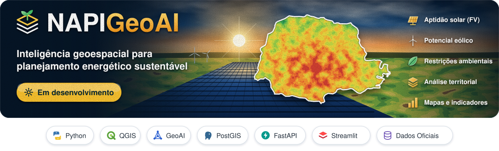

# NAPI GeoAI

<div align="center">



[](ROADMAP.md)
[](docs/ARQUITETURA.md)
[](docs/ARQUITETURA.md)

</div>

**Plataforma de inteligência geoespacial para o planejamento energético sustentável.**

**Idioma:** [Português](README.md) | [English](README.en.md)

> **Status:** em desenvolvimento, sem implantação pública. O repositório já integra artefatos territoriais com proveniência: municípios IBGE 2025 (MVP 09), painel SIGA/ANEEL (MVP 10) e estimativas populacionais IBGE 2026 (MVP 11). Isso é validação de dados e de contratos no repositório. Não é aplicação em produção, não é aptidão fotovoltaica e não é publicação no Streamlit Cloud.

## Visão geral

O NAPI GeoAI é uma iniciativa de pesquisa e desenvolvimento liderada por **Anuar Mincache**, membro do **NAPI Energia Zero Carbono (NAPI EZC)**. O objetivo é desenvolver uma plataforma reprodutível para integrar dados geoespaciais públicos, avaliar cenários de planejamento energético e disponibilizar mapas, indicadores e relatórios científicos.

O primeiro caso de uso planejado é a **avaliação preliminar da aptidão territorial para sistemas fotovoltaicos no Paraná**. A aptidão não equivale a viabilidade técnica, econômica, ambiental ou regulatória de implantação.

## Objetivos

- Conectar fontes oficiais de dados por APIs e formatos geoespaciais documentados.
- Aplicar processamento raster e vetorial com Python e QGIS/PyQGIS.
- Desenvolver um motor científico independente da interface.
- Disponibilizar mapas e cenários em um aplicativo Streamlit, com API FastAPI.
- Registrar proveniência, versões dos dados, parâmetros e validações.
- Oferecer interface e documentação em português e inglês.

## Arquitetura planejada

```text
Fontes públicas (API / CSV / GeoTIFF / serviços GIS)
           ↓
Conectores e validação de dados
           ↓
Processamento científico (Python, QGIS/PyQGIS)
           ↓
Banco geoespacial (PostgreSQL/PostGIS) + arquivos raster
           ↓
API (FastAPI) → Interface (Streamlit PT/EN)
```

**Desenvolvimento:** Cursor + QGIS MCP + GitHub. A inclusão de Airflow será avaliada conforme a complexidade dos pipelines; Kafka não faz parte do MVP.

## Fontes candidatas

- INPE/LABREN — dados de recurso solar.
- ANEEL — dados de geração.
- IBGE — limites e identificação territorial.
- MapBiomas — cobertura e uso da terra.
- ONS e órgãos ambientais — dados adicionais, conforme disponibilidade e licenças.

Cada fonte será avaliada quanto a formato, licenciamento, resolução, atualização e qualidade. A lista acima não implica que os conectores já estejam implementados.

## Equipe e reconhecimento

**Idealização e liderança técnica:** Anuar Mincache.

**Colaboradores científicos (participação confirmada pelo responsável do projeto):** Luiz Fernando Cotica; Ivair Aparecido Santos; Gustavo Sanguino Dias.

Veja [AUTHORS.md](AUTHORS.md). O projeto está inicialmente hospedado nesta conta pessoal. Eventual vinculação ou transferência institucional dependerá de definição e autorização apropriadas.

## Plano de desenvolvimento

Consulte [ROADMAP.md](ROADMAP.md) e [docs/ARQUITETURA.md](docs/ARQUITETURA.md).

## Desenvolvimento local (Windows)

A fundação Python desta fase foi validada localmente com `uv`, Python 3.12, `ruff check` e `pytest`. Guia completo: [docs/INSTALACAO_WINDOWS.md](docs/INSTALACAO_WINDOWS.md).

```powershell
uv python install 3.12
uv venv --python 3.12
.\.venv\Scripts\Activate.ps1
uv pip install -e ".[dev,db]"
ruff check .
pytest -q
```

O pacote `geoai/` inclui fundação Python e, no MVP 02, conector IBGE + validação do limite do Paraná (produto técnico territorial). Ainda não há aplicação publicada nem mapas de aptidão solar.

Documentação do recorte: [docs/FONTES_LIMITES_PARANA.md](docs/FONTES_LIMITES_PARANA.md), [docs/QGIS_MCP.md](docs/QGIS_MCP.md), [docs/MVP02_RESULTADOS.md](docs/MVP02_RESULTADOS.md). O CRS de mapa EPSG:31982 (UTM 22S) é para visualização da maior parte do estado; a faixa oeste exige UTM 21S/outra projeção justificada para métricas estaduais.

Catálogo de fontes e contratos de ingestão (MVP 03): [docs/FONTES_OFICIAIS.md](docs/FONTES_OFICIAIS.md), [docs/CONTRATOS_INGESTAO.md](docs/CONTRATOS_INGESTAO.md).

Fundação PostGIS local (MVP 04): [docs/BANCO_DADOS.md](docs/BANCO_DADOS.md), [docs/MVP04_RESULTADOS.md](docs/MVP04_RESULTADOS.md). Com Docker disponível: `docker compose up -d`, definir `DATABASE_URL` a partir de `.env.example`, `py -3 scripts/migrate_db.py` e `py -3 scripts/import_parana_boundary_db.py`. Testes marcados `postgis` exigem banco real; no CI usam o serviço gratuito `postgis/postgis`. A conta Supabase remota **não** é usada neste MVP.

Operação / robustez (MVP 05): [docs/OPERACAO_BANCO.md](docs/OPERACAO_BANCO.md) — `py -3 scripts/db_ops.py doctor|backup|restore-verify|security-audit`. Neste host WSL o Postgres nativo escuta em **5433**.

Arquitetura modular e qualidade (MVP 06): [docs/ARQUITETURA_MODULAR.md](docs/ARQUITETURA_MODULAR.md), [docs/MVP06_RESULTADOS.md](docs/MVP06_RESULTADOS.md) — contratos de qualidade, domínios temáticos e metadados didáticos **sem** site/ML/novos conectores.

Interface demonstrativa (MVP 07): [docs/STREAMLIT_UI.md](docs/STREAMLIT_UI.md), [docs/MVP07_RESULTADOS.md](docs/MVP07_RESULTADOS.md).

Preparação Community Cloud (MVP 08): [docs/MVP08_DEPLOY.md](docs/MVP08_DEPLOY.md), [docs/MVP08_RESULTADOS.md](docs/MVP08_RESULTADOS.md). **Não** há publicação automática; Supabase permanece fora desta etapa ([docs/SUPABASE_FUTURE.md](docs/SUPABASE_FUTURE.md)).

Explorador territorial (MVP 09): [docs/MVP09_EXPLORADOR.md](docs/MVP09_EXPLORADOR.md) — 399 municípios IBGE, busca, cidades-polo e comparação sem indicadores inventados.

Painel energético SIGA/ANEEL (MVP 10): [docs/MVP10_ENERGIA.md](docs/MVP10_ENERGIA.md) — capacidade fiscalizada (MW) por município, fase Operação, join QGIS, MMGD fora do escopo.

População IBGE 2026 e ficha municipal (MVP 11): [docs/MVP11_POPULACAO.md](docs/MVP11_POPULACAO.md) — estimativa 01/07/2026, densidade, kW/hab SIGA, 399 municípios.

Fundação de jobs geoespaciais (Issue #40): [docs/PROCESSAMENTO.md](docs/PROCESSAMENTO.md). O Streamlit continua lendo artefatos prontos. Jobs locais ficam em `scripts/run_geo_job.py`, com publicação atômica, lock local por chave e `data/jobs/` fora do Git. Medição pequena: `docs/evidence/processing/benchmark_small.json`.

Piloto Sentinel-2 em Maringá, CD_MUN 4115200 (Issue #42): [docs/SENTINEL_PILOTO.md](docs/SENTINEL_PILOTO.md). A geometria sai da malha IBGE 2025. A passagem S2B de 2026-11-12, órbita R081, é a candidata geométrica, com as tiles 22KCV e 22KDV. A sobreposição usa a primeira tile válida, sem média e sem contar o pixel duas vezes. A fração válida ainda não foi medida. O acesso OIDC não foi tentado porque não há credencial local, e o GET anônimo ao B04 respondeu 401. Não há raster nem mapa de NDVI. A página só lê o catálogo.

```powershell
py -3 -m pip install -e ".[dev,ui]"
py -3 -m streamlit run app/Home.py
```

## Reprodutibilidade e responsabilidade

Não serão apresentados dados ilustrativos como resultados científicos. Critérios de aptidão, restrições territoriais e pesos devem ser transparentes, revisados e submetidos a análise de sensibilidade. Nenhuma decisão de investimento deve ser tomada exclusivamente com base em mapas preliminares.

## Licença

**Ainda não definida.** O repositório é público para consulta, mas não há licença de reutilização concedida neste momento. A licença será escolhida após avaliação dos requisitos institucionais e de propriedade intelectual.
